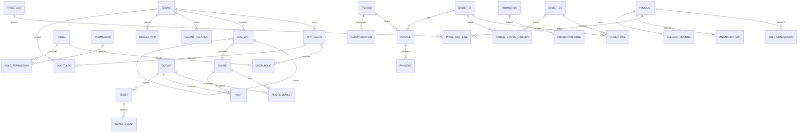

# SYNERA backend database

## Database target safety

Database commands require both `APP_ENV=dev` and `DB_ENVIRONMENT=dev`, a PostgreSQL JDBC `DB_URL`, and a URL without a production marker. `reset:dev` additionally requires `RESET_DEV_CONFIRM=YES`. Do not point these variables at production. The project has not verified or run against a Railway development database.

`SEED_DEMO=true` enables demo fixtures at application startup only in `dev` or `staging`. Demo credentials are hashed with the application's bcrypt encoder and read from `SEED_DEMO_PASSWORD`; the password is not stored in seed files or this repository.

## Authentication and authorization

The API is stateless and uses bearer JWTs. Configure `AUTH_JWT_SECRET` with at least 32 bytes through the environment/secret manager; never commit it. Access tokens live 15 minutes; refresh tokens default to 30 days. `AUTH_REFRESH_TOKEN_DAYS`, `AUTH_LOGIN_MAX_FAILURES`, and `AUTH_LOGIN_LOCK_MINUTES` can tune those limits.

Use `/api/v1/auth/login`, `/refresh`, `/logout`, and `/me`; `/api/auth/*` remains an alias for existing clients. Login returns an access token and a one-time refresh token. Refresh-token hashes and device/family metadata are stored in PostgreSQL; every successful refresh rotates the token, and reuse revokes its family. Login failures are rate-limited per normalized email in `auth_login_attempt`.

New passwords use bcrypt (maximum 72 UTF-8 bytes). The encoder also verifies existing Spring PBKDF2 hashes and upgrades them to bcrypt after a successful login when they fit that limit. Public registration is disabled because account creation must assign a tenant and role. Account provisioning/invitations are not implemented in this phase.

Endpoints can use `@RequirePermission("module:action")`; the permission interceptor checks the signed access-token grants. `PermissionScopeResolver.resolveScope(jwt, permission)` resolves A/R/T/O from the token's tenant, org-unit and route claims, and fails closed for empty R/T assignments. Repository queries for business domains must apply that resolved scope in addition to `tenant_id`; no order, finance, or inventory APIs exist yet. `DataVisibilityPolicy` provides reusable sell-in-price, internal-note, and NPP credit visibility rules. `AuditService.recordIfSensitive` writes changes only when the seeded permission is marked sensitive; role assignment currently uses this path.

The initial browser client keeps tokens in module memory, not local storage. A full page reload therefore requires signing in again; durable browser refresh-cookie handling should be completed when the frontend API client is wired in a later phase.

## Commands

Run from the repository root in PowerShell, after setting database variables through a local secret manager or shell environment:

```powershell
.\backend\scripts\db.ps1 -Task migrate
.\backend\scripts\db.ps1 -Task seed:system
.\backend\scripts\db.ps1 -Task seed:demo
.\backend\scripts\db.ps1 -Task reset:dev
```

`seed:demo` requires `SEED_DEMO_PASSWORD`. `reset:dev` is destructive, is never run automatically, and requires explicit confirmation. It migrates and reseeds system data; demo fixtures are included only when `SEED_DEMO=true` and a demo password is configured.

Flyway migrations are forward-only and live in `src/main/resources/db/migration`. System seed input, exported from the workbook, is `src/main/resources/seed/system-seed.json`; demo fixture input is `src/main/resources/seed/demo-seed.json`.

## Schema relationship overview



`order_line` quantity columns store integer base units; `unit_code` and `entered_unit_code` preserve the commercial/entered unit. Cross-table tenant consistency and approval authorization remain service-layer responsibilities; the schema adds tenant ownership columns and DB checks for nonnegative quantities, quantity progression, self-approval, idempotency keys, and order status transitions.
