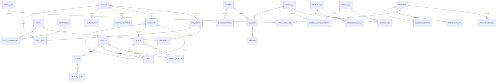

# SYNERA backend database

## Database target safety

Database commands require both `APP_ENV=dev` and `DB_ENVIRONMENT=dev`, a PostgreSQL JDBC `DB_URL`, and a URL without a production marker. `reset:dev` additionally requires `RESET_DEV_CONFIRM=YES`. Do not point these variables at production. The project has not verified or run against a Railway development database.

`SEED_DEMO=true` enables demo fixtures at application startup only in `dev` or `staging`. Demo credentials are hashed with the application's PBKDF2 encoder and read from `SEED_DEMO_PASSWORD`; the password is not stored in seed files or this repository.

## Commands

Run from the repository root in PowerShell, after setting database variables through a local secret manager or shell environment:

```powershell
.\backend\scripts\db.ps1 -Task migrate
.\backend\scripts\db.ps1 -Task seed:system
.\backend\scripts\db.ps1 -Task seed:demo
.\backend\scripts\db.ps1 -Task reset:dev
```

`seed:demo` requires `SEED_DEMO_PASSWORD`. `reset:dev` is destructive, is never run automatically, and requires explicit confirmation. It migrates and reseeds system data; demo fixtures are included only when `SEED_DEMO=true` and a demo password is configured.

Flyway migrations are forward-only and live in `src/main/resources/db/migration`. System seed input, exported from the workbook, is `src/main/resources/seed/system-seed.json`; demo fixture input is `src/main/resources/seed/demo-seed.json`.

## Schema relationship overview



`order_line` quantity columns store integer base units; `unit_code` and `entered_unit_code` preserve the commercial/entered unit. Cross-table tenant consistency and approval authorization remain service-layer responsibilities; the schema adds tenant ownership columns and DB checks for nonnegative quantities, quantity progression, self-approval, idempotency keys, and order status transitions.
